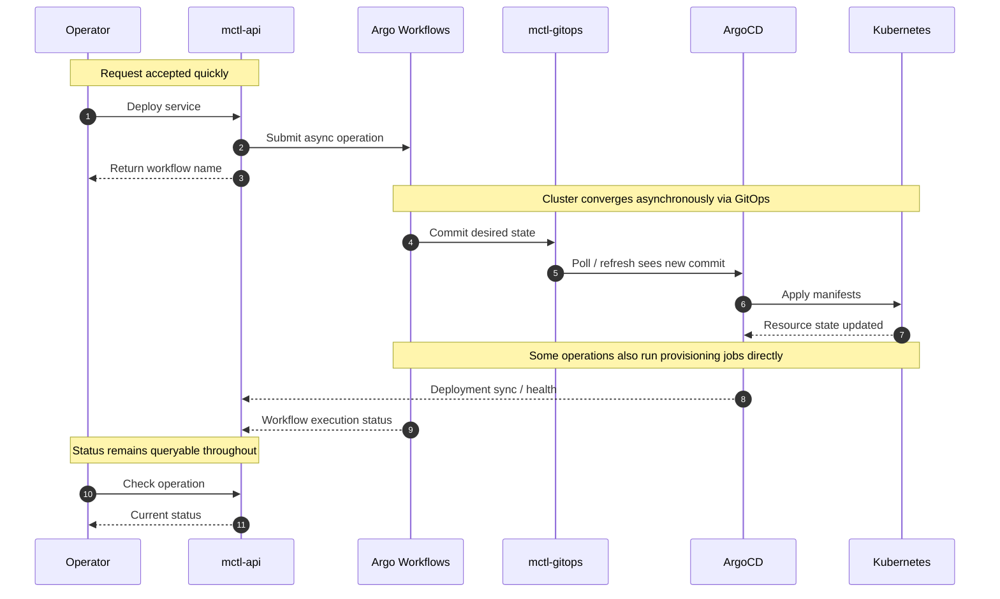

# GitOps Workflows

Declared service configuration in MCTL flows through Git. Registry writes, secrets and ephemeral preview operations have their own persistence and execution paths. ArgoCD watches the `mctl-gitops` repository and syncs the cluster to match the desired state.

## How GitOps Works in MCTL



## Argo Workflows

Long-running operations (deploy, scale, rollback) are executed as Argo Workflows. You can:

### List Workflows

```
"Show me running workflows in staging"
```

### Check Workflow Status

```
"What's the status of workflow deploy-my-app-xyz?"
```

Workflow UI is available at [workflows.mctl.ai](https://workflows.mctl.ai) for accounts with a separate access grant; MCP status/log tools do not require that UI grant.

## Repository Structure

The `mctl-gitops` repository is organized by tenant:

```
platform-gitops/
  services/
    admins/           # Platform services (mctl-api, mctl-web, etc.)
      mctl-api/
      mctl-web/
      mctl-docs/
    team-alpha/     # Tenant-scoped services
      my-app/
      my-api/
    team-beta/
      ...
```

## CI/CD Integration

Onboarding alone does not install a deploy job in your repository. Use the
[scaffolding CI example](/guides/scaffolding) to submit a deployment after your
checks and tag creation. That job authenticates with GitHub Actions OIDC; the
platform workflow performs the central build and deployment. A successful trigger
job proves submission, not the completion of the downstream rollout.

Platform repositories also use release-please and repository-specific deployment
workflows. Consult each repository's workflow files instead of assuming that every
tag or push has identical effects.

## Grant Repository Access

To connect a GitHub repository to a tenant for automated deployments:

```
"Grant access to repo myorg/my-app for the staging tenant"
```
